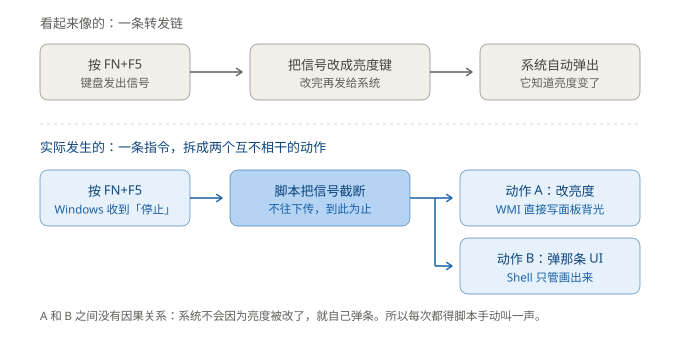

# keyboard-brightness

把键盘上任意两个键，改成屏幕亮度的「暗一点」和「亮一点」。按下去弹的是 **Windows 自己的亮度条**，不是自己画的。

## 这是什么

一个常驻后台的小程序。键盘上没有亮度键（或者那两个键你从来不用），就在配置文件里指定两个键，它们从此负责调亮度。改键不改代码，全部在 `配置.ini` 里。

## 为什么需要它

笔记本的屏幕亮度本来靠 Fn 组合键调。换了外接键盘之后，键盘上没有亮度键，这个功能就没了。

有人第一反应是「刷固件改键」。这条路走不通。这类几十块钱的键盘用的是掩膜在芯片里的公版主控（我这把是 China Resource Semico 的 `1A2C:40E2`），没有固件升级口、没有厂商驱动、也不支持 QMK/VIA。想改等于换主控。

但根本不用动固件。**Fn 键根本不进操作系统**——你按 Fn+F5，是键盘芯片自己把它翻译成一个标准「停止播放」信号发给 Windows，系统从来不知道你按了 Fn。所以只要在系统这一层把这个信号截下来换成调亮度，效果跟原生亮度键完全一样。

## 为什么不用编译好的 exe

有条更省事的路：AutoHotkey 有官方打包工具 `Ahk2Exe`，能把脚本编译成一个独立的 exe，双击就跑，用户感知是「一个绿色小工具」。

我先试了这条，然后放弃了。

`Ahk2Exe` 打出来的东西，一落地就被 360 拦。把打包工具改名（`Ahk2Exe.exe` → `a.exe`）照样拦，它不是按文件名认的。而这类小工具最容易被误判：无签名、体积小、开机自启、还全局抓键盘。真要跟安全软件反复纠缠、让用户点「允许」，成本比这个程序本身还大。

最后用的办法是：**拿官方发布的 AutoHotkey64.exe 原样复制一份，改个中文名，一个字节都不动**（SHA256 与原版逐字节一致），然后把脚本写成跟它同名的 `.ahk` 放在旁边。AutoHotkey 有个行为——exe 启动时如果同目录下有个同名脚本，就直接加载它。于是双击 `键盘亮度.exe` 就等于「用官方引擎跑我的脚本」，不需要打包，也不需要传参数。

好处不止是躲扫描：

1. 程序本体是一份**纯文本 `.ahk`**，谁都能打开看，不用信任一个黑盒二进制。
2. 没有「编译」这一步，改了配置不用重新打包。
3. 仓库里可以不放任何二进制。谁要装，安装脚本自己去官方站点拉引擎，法律上也干净（AutoHotkey 是 GPLv2）。

代价是文件夹里必须有那个 1.2MB 的 exe 陪着。要发给别人时两个文件得一起给。

## 它做了什么

1. 盯着 `配置.ini` 里指定的两个键，按一下亮度变 5 点（步长可改）
2. 通过 WMI 的 `WmiSetBrightness` 真正改背光
3. 调 Windows Shell 里那个未公开的 Flyout 控制器，让系统自己弹出亮度条
4. 改键、改步长、绑键盘、开关自启、开关日志——全在 `配置.ini`，不需要改代码

第 3 步是这套东西里最有意思的部分，详见下面。

代价是这两个键原来的功能没了（默认吃掉「停止」和「上一曲」）。常用这两个键的话，换两个不常用的键就行。

## 链路长什么样

很多人第一反应是「截下信号、改一下、再发给系统，系统自己就知道该弹什么」。不是这样。

真实情况是：脚本把原信号**截断**了（不往下传，否则你正在听的歌会被这个「停止」键按停），然后自己分别调两个完全不同的接口——一个走 WMI 改背光，一个走 Shell 弹界面。这两件事之间没有因果关系，系统不会因为亮度变了就弹条，所以每按一次键，弹条这个动作都得脚本单独请求一次。

<p align="center"></p>

有两个现象能反过来证明这两件事是独立的。把这套逻辑里的「弹条」去掉，亮度照样变，只是没有任何视觉反馈——最早的版本就是这样，用了好几天都没觉得不对。反过来只弹条不改亮度，条会正常出来、显示当前值，但滑块一动不动。

顺带说一句为什么不走「让系统自己弹」那条路。理论上可以伪造一个硬件层的亮度变更事件，假装显示器在报告，那样系统就会自己弹。但这等于往系统里塞假的设备报文，比调一个 UI 接口的风险大得多，而且不再是只读式调用。

## 装

两条路，效果一样。

**第一条，下 ZIP。** 在 GitHub 页面点 `Code → Download ZIP`，解压，双击里面的 `安装.bat`。脚本会被拦一次（`ExecutionPolicy`），`安装.bat` 已经带好了绕过参数，不用手动改策略。

**第二条，clone。**

```powershell
git clone https://github.com/Foreverwonder/keyboard-brightness.git
cd keyboard-brightness
powershell -ExecutionPolicy Bypass -File .\install.ps1
```

`install.ps1` 会做五件事：从官方站点拉 AutoHotkey v2 便携版（1.2MB，只用其中的引擎）、装到 `%LOCALAPPDATA%\键盘亮度`、写一条**用户级**开机自启（不需要管理员）、结束旧实例、立刻启动。

装完按一下键盘上的「停止」键，亮度应该降 5 点，屏幕弹出系统亮度条。

**关于键盘绑定**：仓库里这份 `config.ini` 的 `键盘ID` 是空的，意思是任何键盘上那两个键都会触发亮度。想做成「只让外接键盘生效、不干扰笔记本自带键盘」，把外接键盘的 ID 填上就行——装完改 `%LOCALAPPDATA%\键盘亮度\配置.ini`，或者装之前先改仓库里这份。

如果你是按第一条路装的，改的是装好之后那一份：`%LOCALAPPDATA%\键盘亮度\配置.ini`。改仓库里的样例不影响已经在跑的进程。

查自己键盘的 ID：

```powershell
Get-CimInstance Win32_PnPEntity | Where-Object { $_.DeviceID -like '*VID_*PID_*' } |
    Select-Object Name, DeviceID
```

找到键盘那一项，取 `VID_xxxx&PID_xxxx` 这一段填进去。

## 改键

三种改法，都不用碰代码。

**直接填名字。** 打开 `配置.ini`，`[按键]` 那一段：

```ini
变暗=MediaStop
变亮=MediaPrev
```

等号后面可以写 `MediaStop`、`MediaNext`、`MediaPlayPause`、`VolumeUp`、`BrowserBack` 这类多媒体键名，也可以写 `F5`、`F7`、`A`、`1`，组合键写 `^!F5`（`^` 是 Ctrl、`!` 是 Alt、`+` 是 Shift）。

**让它自己学。** 懒得查键名就把等号后面改成一个问号：

```ini
变暗=?
```

保存后重启程序，它会「滴」两声，在屏幕左上角提示你按键。你在键盘上按一下想用的那个键，它就把键名写回配置文件。两颗键都认完了，热键才生效。

**换键盘。** 换一把完全没有多媒体键的键盘，把 `键盘ID` 改成新键盘的，或者清空，按键名字不用动。

## 配置项

| 段 | 键 | 说明 |
| --- | --- | --- |
| `[按键]` | `变暗` / `变亮` | 键名，见上。填 `?` 进入学习模式 |
| `[亮度]` | `步长` | 每按一下变化多少，1–50，默认 5。填非法值会自动回落到 5 |
| `[设备]` | `键盘ID` | 只在含这串 ID 的设备在位时响应。留空 = 任何键盘 |
| `[其他]` | `开机自启` | `是` / `否`。程序每次启动都会核对注册表，路径变了会自己改回来 |
| `[其他]` | `记日志` | `是` / `否`。写到同目录 `bright.log`，超过 100KB 自动清空 |

改完保存，右键托盘图标选 `Reload This Script`，或者关掉重开。不用改代码。

## 这条映射到底绑定到谁

`键盘ID` 绑的是**型号**，不是某一把握在手里的键盘。这个区别值得说清楚，因为大多数人第一反应是「它只听我这一把」。

换一颗别的型号的键盘，热键压根不会注册，各走各的，互不干扰。拔掉键盘，系统广播设备变更消息，脚本把热键整个关掉；插回来再打开。换 USB 口、过扩展坞、走 USB Hub 都不影响，VID/PID 烧在键盘固件里，跟插哪儿无关。买一把同型号的新键盘来替换，照样生效——从系统的角度看它们确实是同一把。

有一个场景防不住：**两颗键盘同时插着的时候**。

热键注册在系统层面，只看键码，不看这个码从哪颗键盘来。所以当目标键盘在位、热键处于启用状态时，另一颗键盘上如果也有「停止」或「上一曲」键，按了同样会调亮度。这个不是实现偷懒，早前用程序模拟按一下「停止」（模拟事件不带任何来源信息），亮度照样变了，反过来证明热键只看键码。

往上追是死路。`RegisterHotKey` 和低级键盘钩子都只给键码，不给设备句柄；RawInput 能拿到设备句柄，但它只是旁路监听，没有拦截按键的能力。一个知道来源但拦不住，一个拦得住但不知道来源，这两样在 Windows 里拼不到一起。所以「精确到某一把物理键盘，并且把按键截走」不是工程量的问题，是这条路本身不通。

实际碰到的概率不高。多数笔记本内建键盘没有独立的「停止」键，输入法、聊天软件那种虚拟键盘也不会主动发媒体键。真撞上了表现很明显——按了别的键，亮度莫名其妙变了，两秒就能反应过来，把脚本关掉就行。

想确认这套绑定逻辑在你机器上是通的，可以做个反向验证：把 `键盘ID` 改成一个不存在的值（比如 `VID_0000&PID_0000`）重启脚本，日志里会写出「键盘不在 → 映射停用」，这时候按什么键都不会动亮度。

## 那个亮度条是怎么来的

Windows 从来没公开过「显示亮度 OSD」的 API。第三方亮度工具（Twinkle Tray、Monitorian 之类）基本都是自己画一条。

但系统内部其实有接口。Shell 里有个未公开的浮层控制器，调用链是这样的：

1. `CoCreateInstance` 创建 ImmersiveShell，CLSID `{C2F03A33-21F5-47FA-B4BB-156362A2F239}`
2. `QueryInterface` 到 `IServiceProvider` `{6D5140C1-7436-11CE-8034-00AA006009FA}`
3. `IServiceProvider::QueryService` 取 `{41f9d2fb-7834-4ab6-8b1b-73e74064b465}`，得到 FlyoutController
4. 调它的 `ShowFlyout(3, 0)`，`3` 是亮度、`0` 是音量、`1` 是飞行模式

返回 `S_OK` 之后，系统自己会把那条「太阳图标 + 蓝色滑块」弹出来，位置、动画、深浅色主题、DPI 缩放全部原生，一行界面代码都不用写。

接口失效时（Windows 大版本更新、资源管理器重启）脚本只记一行日志，亮度照调，不弹提示条，不崩不卡。界面是锦上添花，调亮度才是本体。

## 常见问题

**按了没反应。** 先看同目录的 `bright.log`。有「键盘在位 → 映射启用」说明脚本活着、设备认到了，问题在键码；连「启动」这行都没有说明脚本没启动；有「键盘不在 → 映射停用」说明 `键盘ID` 对不上。

**改了配置没反应。** 配置只在启动时读一次，改完要重启程序（或者托盘菜单里 `Reload This Script`）。另外注意别用会存成 ANSI 的老编辑器——脚本按 UTF-8 读，读不到中文段名时会自动按 GBK 再试一次，两种情况都记日志，但存成别的编码就没辙了。

**日志是乱码。** 脚本写的是 UTF-8，PowerShell 5.1 的 `Get-Content` 默认按 ANSI 读会花屏。加 `-Encoding UTF8`，或者用编辑器打开。

**亮度变了但没弹条。** OSD 接口失效了，功能正常，只是少了视觉反馈。

**按一下跳了 10 点。** 大概是开了两份程序（比如装了两次、或者把备份文件夹里的 exe 也点开了）。脚本只保证同一个路径只跑一份，不同路径的两份互不知道。任务管理器里搜 `键盘亮度` 关掉多余的。

**想确认自己的键盘发的是什么键。** 写个 AutoHotkey 的 `InputHook("L0 I0")` 探测，把 `{All}` 的 `N` 选项打开，`OnKeyDown` 里记 `vk` 和 `sc`。更好的办法是直接用这个程序的 `?` 学习模式，它认完会把键名写回配置，省得自己猜。

**插了两把键盘，按另一把的「上一曲」，结果亮度变了。** 热键是全局的，不区分来源，见上面「这条映射到底绑定到谁」。这个改不掉，临时办法是把脚本关掉。

## 卸载

双击 `卸载.bat`，或者：

```powershell
powershell -ExecutionPolicy Bypass -File .\uninstall.ps1
```

删注册表自启项、结束进程、删掉程序目录，三步干净。手动作也行：注册表 `HKCU\Software\Microsoft\Windows\CurrentVersion\Run` 里删掉 `KeyboardBrightness`，结束 `键盘亮度.exe`，删目录。

## 已知限制

**只管笔记本内屏。** WMI 那套亮度接口管的是面板背光，外接显示器走的是 DDC/CI，是另一条路，这个脚本不管。合盖外接屏当主屏时，亮度确实在变，但你在外接屏上看不到任何反馈。

**独占全屏的游戏里可能不响应。** 部分游戏用 RawInput 直接读设备，绕过了系统的低级键盘钩子，热键收不到。无边框全屏一般没事。

**锁屏、UAC 安全桌面上不生效。** 那是另一个桌面，钩子够不着。

**只验证过 Windows 11**（3072×1920 / 200% 缩放）：Windows 10 应该也能跑，但亮度 OSD 那个内部接口在旧版本上行为可能不一样。

**多键盘串扰**：两颗键盘同时插着的时候，另一颗上的同键码也会被截走。这是 Windows 热键机制的限制，改不掉，原因写在上面「这条映射到底绑定到谁」。

**同型号键盘无法区分**：认的是 VID/PID，两把同型号的键盘在脚本眼里是同一把，插哪把都能调亮度。

**没有数字百分比**：系统原生的亮度条只有太阳图标和滑块，不显示「65%」这样的数字。音量条上的数字是音量条独占的，亮度条天生没有。

## 踩过的坑

1. **AutoHotkey 变量不能叫 `LOG`**。`Log` 是内置数学函数，赋值直接语法错误，脚本一行都不执行，进程挂在错误弹窗上，从外面看特别像被安全软件杀了。
2. **错误弹窗比错误本身更烦人**。这是个后台工具，任何异常都应该只写日志，绝不能在屏幕中间弹个框打断正在干活的人。所以脚本第一行就装 `OnError` 兜底——注意必须装在读配置之前，因为配置读崩了也会弹框，而那正是最容易崩的地方。
3. **`Ahk2Exe` 的产物被 360 拦**，改名无效。原因和替代方案写在上面「为什么不用编译好的 exe」。
4. **这个版本的引擎写不进注册表**。`RegWrite` 参数校验失败，读得到写不了。改用 WMI 的 `StdRegProv.SetStringValue`，HKCU 的根键常量是有符号的 `-2147483647`，写成 `0x80000001` 会报类型错误。
5. **`IniRead` 按系统 ANSI 读文件**，配置文件里的中文键名直接读不出来。自写一个 UTF-8 逐行解析的版本，读写统一。
6. **`TrayTip` 和 `A_TrayMenu` 系列在这台机器上会卡死进程**，托盘相关 API 全部弃用，只留引擎自带的默认菜单。
7. **`ComObjQuery` 在 v2 返回的是对象，要取指针才能继续调**；`ImmersiveShell` 必须走 `QueryService`，直接 `QueryInterface` 拿 Flyout 会返回 `E_NOINTERFACE`。
8. **全局自绘 GUI 若先做 `CreateRoundRectRgn` 裁剪，文字不渲染**。试过自己画圆角胶囊，窗口出来是个空框。最后改用系统 OSD，这个问题自然消失了。
9. **真实键盘和程序模拟出来的扫描码不一样**。FN+F5 实测是 `VK=0xB2` / `SC=0x124`，带扩展位；用 `keybd_event` 模拟同一个键出来的是 `SC=0x024`。热键写成 `*vkB2` 按虚拟键匹配就没这个问题，要是按扫描码绑，模拟测试全绿、真按下去没反应。`*` 前缀是通配修饰符，键盘在组合键状态下带隐藏修饰键时也能响应。
10. **`FileDelete` 删不存在的文件会抛异常**，必须先 `if FileExist`。日志轮转那行就踩过。
11. **`#SingleInstance` 只认路径**，两个不同目录里的同名脚本可以同时跑，会变成按一下跳两格。配置里那句「别开两份」不是废话。
12. **PS 5.1 的 `Start-Process` 会在环境变量上翻车**。同一台机器上同时存在 `HTTPS_PROXY` 和 `https_proxy` 时，它构造进程环境的字典会抛「已添加项」。安装脚本里对这种情况做了兜底，改用 WMI 起进程。
13. **`Get-Process AutoHotkey64 | Stop-Process` 会误杀别人的脚本**。正确做法是按 `Win32_Process` 的 `CommandLine` 匹配自己的脚本路径再杀，`install.ps1` 和 `uninstall.ps1` 都是这么写的。

## 版本历史

`v3` 换成「官方引擎原样改名 + 同名脚本自动加载」，不再编译 exe；配置全部外置到 `配置.ini`；支持 `?` 学习按键；增加设备在位判断和原生 OSD。

`v3.1` 加了四道保险：配置存成 GBK 也能读、步长填错不崩、两个动作填同一个键会当场记日志、长按不连发。

`v1` 最初的版本，亮度固定写死在脚本里，自绘提示条。

## 许可

脚本本身随便用。运行时依赖的 AutoHotkey 是 GPLv2，本仓库不包含它的二进制，安装脚本从 [autohotkey.com](https://www.autohotkey.com/) 下载。
